 "Studio" (https://img.shields.io/badge/ANIMODE-STUDIO_2.1-63f5b3?style=for-the-badge&labelColor=0b1016)
"Output" (https://img.shields.io/badge/OUTPUT-HINDI-63f5b3?style=for-the-badge&labelColor=0b1016)
"Engine" (https://img.shields.io/badge/ENGINE-PYANNOTE_%2B_FISH_SPEECH-63f5b3?style=for-the-badge&labelColor=0b1016)
"Python" (https://img.shields.io/badge/PYTHON-3.11%2B-63f5b3?style=for-the-badge&labelColor=0b1016)
"License" (https://img.shields.io/badge/LICENSE-MIT-63f5b3?style=for-the-badge&labelColor=0b1016)

DESIGNED & DEVELOPED BY

RAIM AHMED

<code>FOUNDER & DEVELOPER · ANIMODE FUN DUB</code>

 Character voices. Editable dialogue. Controlled timelines. Studio exports.

""BOOT"" (#-boot-sequence) · ""STUDIO"" (#-studio-workflow) · ""TERMINAL"" (#-terminal-mode) · ""API"" (docs/api.md) · ""DEPLOY"" (docs/deployment.md) · ""CREDITS"" (#-credits-and-license)

---

«"SYSTEM ONLINE" — multi-character Hindi dubbing workstation.
A local studio with voice conditioning, review controls and repeatable delivery.»

🌐 Language matrix

<table align="center">
  <tr><th align="left">SOURCE AUDIO</th><th>CODE</th></tr>
  <tr><td>&nbsp; Japanese · 日本語</td><td align="center"><code>ja</code></td></tr>
  <tr><td>&nbsp; English</td><td align="center"><code>en</code></td></tr>
  <tr><td>&nbsp; Korean · 한국어</td><td align="center"><code>ko</code></td></tr>
  <tr><td>&nbsp; Chinese · 中文</td><td align="center"><code>zh</code></td></tr>
  <tr><td>&nbsp; Hindi · हिन्दी</td><td align="center"><code>hi</code></td></tr>
</table><code>▼  DUBBED INTO  ▼</code>

 हिन्दी · HINDI

NLLB tags: ja→jpn_Jpan · en→eng_Latn · ko→kor_Hang · zh→zho_Hans · hi→hin_Deva Flags are visual shorthand for languages.

🚀 Fast boot

After setup (see "Boot sequence" (#-boot-sequence)):

python -m animode.preflight
python -m animode.webui

⚡ Implemented systems

System| Capability
"01" Character analysis| pyannote Community-1; automatic or specified speaker count
"02" Dialogue cleanup| Demucs vocal/music separation, high-pass filtering and gentle FFT denoising
"03" Character voices| Up to three isolated reference clips with matching source-language transcripts
"04" Batch synthesis| Fish Speech S2-Pro reference conditioning; 1–4 workers, separate character profiles
"05" Hindi script| Whisper transcription → NLLB translation; editable source and Hindi text
"06" Studio editor| Speaker reassignment, timestamp edits, voice direction and custom samples
"07" Clip iteration| Preview/regenerate one fitted clip without rerunning the whole video
"08" Generation cache| Reuse unchanged speech; invalidate on text, reference, style, model revision or regeneration
"09" Timeline fitting| Pitch-preserving tempo and exact sample budgets; reject audible end truncation
"10" Mix / master| Background gain; two-pass loudness mastering to -16 LUFS / -1 dBTP targets
"11" Exports| Hindi MP4, mastered WAV, SRT, VTT, CSV and character-track ZIP
"12" Operations| Saved projects, status files, diagnostics, file locks and stale-edit protection
"13" Service| Authenticated API, bounded queue, isolated model subprocess and restart interruption status
"14" Deployment| CLI, Gradio Studio, CPU Docker/Compose baseline and video batch runner

«Profiles are reference-conditioning records, not separately trained voice weights.
The server checkpoint controls synthesis quality. Similar workflow features do not establish equivalent voice quality or service reliability.»

🧬 Signal flow

 INPUT  video file
   │
   ├─[01] SEPARATE    Demucs
   ├─[02] DIARIZE     pyannote
   ├─[03] TRANSCRIBE  faster-whisper
   ├─[04] TRANSLATE   NLLB → Hindi
   ├─[05] REVIEW      edit script
   ├─[06] SYNTHESIZE  Fish Speech
   └─[07] FIT+MASTER  FFmpeg
   │
 OUTPUT  MP4 WAV SRT VTT CSV ZIP

🟢 Boot sequence

«"root@animode:~# ./boot --all"»

Baseline: Linux / WSL2, Python 3.11+, FFmpeg and model download access. CPU inference can be slow. Use separate environments for the main application, Demucs and Fish Speech.

01 · Main environment

sudo apt-get update
sudo apt-get install -y ffmpeg libsndfile1
python3.11 -m venv .venv
source .venv/bin/activate
python -m pip install --upgrade pip
# Select matching torch/torchaudio wheels for your machine before this step.
python -m pip install -e '.[test]'
cp .env.example .env

Requirements are compatibility ranges, not a hardware-tested lockfile. Freeze the resolved versions after testing the real GPU/model stack.

02 · Separation environment

python3.11 -m venv .venv-demucs
.venv-demucs/bin/python -m pip install \
  'numpy<2' 'torch==2.5.1' 'torchaudio==2.5.1' \
  'demucs==4.0.1' soundfile

Set DEMUCS_PYTHON in ".env" to the absolute ".venv-demucs/bin/python" path. This isolation avoids Demucs audio-loading conflicts with pyannote 4's newer PyTorch stack. For CUDA, choose appropriate matching wheels in each environment.

03 · Speaker access

Accept the "Community-1 conditions" (https://huggingface.co/pyannote/speaker-diarization-community-1) and set HF_TOKEN in ".env". Never commit tokens or ".env".

04 · Fish Speech

Follow the "Fish installation instructions" (https://speech.fish.audio/install/) in a separate checkout/environment and download S2-Pro, which supports Hindi. From that checkout:

python tools/api_server.py \
  --listen 127.0.0.1:8080 \
  --llama-checkpoint-path checkpoints/s2-pro \
  --decoder-checkpoint-path checkpoints/s2-pro/codec.pth \
  --decoder-config-name modded_dac_vq

Set FISH_TTS_URL to "http://127.0.0.1:8080/v1/tts" and FISH_API_KEY if authentication is enabled.

FISH_MODEL_ID identifies the checkpoint revision for caching; change it whenever server weights or generation behavior change. This client uses the self-hosted MessagePack API.

05 · Check and launch

python -m animode.preflight
python -m animode.webui

Open http://127.0.0.1:7860. Set "ANIMODE_DEVICE=cuda" for GPU analysis. Fish uses its own device settings. Diagnostics check setup/server availability; a health response does not validate quality or the installed checkpoint.

🎛 Studio workflow

1. Project & setup: run diagnostics; analyze a clip or resume a saved project.
2. Character voices: review IDs, name characters and listen to references. Optionally assign a clean 2–30 second custom voice sample, its exact transcript and voice direction.
3. Dialogue: edit speaker, start/end seconds, source transcript and Hindi. Keep IDs unchanged. Unknown speakers, invalid times and overlaps are rejected. Source edits do not retranslate Hindi.
4. Preview: select a segment and listen to its fitted audio. Regenerate only that clip when necessary; unchanged speech is reused on subsequent renders.
5. Delivery: set music gain, enable mastering and render video/audio/subtitles/character tracks.

References come from non-overlapping source speech. Short or contaminated speakers may require a custom reference. IDs are acoustic clusters, not visual character recognition. Review speaker assignments, reference transcripts and Hindi phrasing.

⏱ Timing contract

<b>Open the contract</b> — what the Studio guarantees, and what it does not
- Boundaries are model estimates; slicing and output use exact rounded sample positions.
- Exclusive diarization allocates one speaker per instant. Secondary simultaneous dialogue may be lost. The app flags this and requires explicit review acknowledgement before rendering.
- Simultaneous characters are not independently separated into perfect isolated voices. Prepare a corrected non-overlapping adaptation manually for those scenes.
- Generated duration determines pitch-preserving tempo. Default range: 0.5×–2×. Edit Hindi wording when the necessary tempo is excessive.
- Extreme-tempo opt-in allows larger adjustments; audible end truncation still stops rendering.
- Speech clips fit their assigned slots. This is audio timing control, not visual lip-sync.
- Mastering targets are not guarantees for every signal. FFmpeg may use dynamic normalization; the mastering report records input measurements. Listen to the final master.

💻 Terminal mode

python dub_video.py anime.mp4 \
  --source-language ja --device cuda --analyze-only

python dub_video.py --job outputs/JOB_ID/job.json \
  --output hindi.mp4

python dub_video.py --job outputs/JOB_ID/job.json \
  --voices voices.example.json

python dub_video.py --job outputs/JOB_ID/job.json \
  --accept-source-overlap

python -m scripts.inference.batch_process clips/ \
  --analyze-only --device cuda

Replace example voice paths/transcripts before using them. Other controls: "--no-background", "--background-gain", "--workers", "--force-tempo" and "--no-master". CLI job/voice JSON files are trusted local inputs with filesystem paths. New projects own a source-video copy, so Gradio upload-cache cleanup will not break them. Existing v2.0 jobs retain their external source path.

After "pip install -e ." these shortcuts are also available:

"animode-check" · "animode-ui" · "animode-api" · "animode-dub"

📦 Delivery files

File| Contents
"animode_hindi.mp4"| H.264 video and Hindi AAC
"hindi_master.wav"| Mastered stereo 48 kHz / 24-bit WAV; "--no-master" retains internal mix format
"hindi.srt" / "hindi.vtt"| Hindi subtitles
"hindi.csv"| Speaker/time/source/Hindi; formula-leading cells escaped
"studio_exports.zip"| Master, subtitles, CSV, timing, character tracks and "tracks.json"
"timing.json"| Segment sample bounds and tempo ratios
"mastering.json"| Input loudness analysis when mastering is enabled
"job.json" / "status.json"| Private local project and operation state

Character WAVs use the full video timeline at 24 kHz with the mix's dialogue gain. The ZIP uses relative filenames and excludes source video, credentials and private absolute-path manifests.

🔌 Service and deployment

See "API" (docs/api.md), "deployment" (docs/deployment.md) and "configuration" (docs/configuration.md).

The API is a single-operator, single-worker service with up to eight queued/running tasks. Restarted unfinished tasks become interrupted; synthesis is not automatically repeated. Completed analysis can be resumed for rendering, but there is no per-stage automatic analysis recovery.

The token does not implement accounts, billing or tenant isolation. Keep localhost bindings unless you add appropriate access controls. Do not share a live project root between front ends. Data, caches and logs remain until removed. UI/API limits: 1 GiB upload / 30 minutes.

🧪 Verification

python -m pytest tests/animode -q
python -m ruff check animode dub_video.py \
  scripts/inference/batch_process.py tests/animode

"VALIDATION.md" (VALIDATION.md) distinguishes completed checks from remaining acceptance work.

Synthetic/fake-model tests cannot establish natural Hindi, voice similarity, anime diarization, GPU compatibility or uptime. Run real two-character footage before adopting the stack.

🧩 Project map

animode-fun-dub/
├── animode/           engine + Studio
│   ├── pipeline.py    analyze → render
│   ├── audio.py       slice · fit · mux
│   ├── diarization.py pyannote turns
│   ├── models.py      Whisper + NLLB
│   ├── fish.py        Fish Speech client
│   ├── editor.py      validated edits
│   ├── exports.py     master · stems
│   ├── webui.py       Gradio Studio
│   ├── api.py         authenticated API
│   ├── tasks.py       job queue
│   ├── worker.py      model subprocess
│   ├── state.py       status · locks
│   └── preflight.py   diagnostics
├── dub_video.py       CLI
├── scripts/           batch · setup
├── tests/animode/     test suite
└── docs/              guides

🏆 Credits and license

PROJECT ARCHITECT & LEAD DEVELOPER

RAIM AHMED

ANIMODE FUN DUB STUDIO

<code>DESIGNED · DEVELOPED · MAINTAINED</code>

© 2026 Animode Fun DUB · "MIT License" (LICENSE)

All original Studio code, documentation and design in this repository are © 2026 Animode Fun DUB and released under the "MIT License" (LICENSE).

Keep the credit. The MIT License requires the copyright notice and license text to stay with every copy or substantial portion. If you fork, mirror or redistribute this project, retain the original copyright notice and license text.

Models and media are not covered. This license does not relicense model weights. "NLLB" (https://huggingface.co/facebook/nllb-200-distilled-600M) and "Fish S2-Pro" (https://huggingface.co/fishaudio/s2-pro) have their own licensing terms. Check the applicable licenses before commercial use. The default stack is not commercially cleared.

Powered by "pyannote" (https://huggingface.co/pyannote/speaker-diarization-community-1) · "Fish Speech" (https://speech.fish.audio/inference/) · "Demucs" (https://github.com/facebookresearch/demucs) · "NLLB" (https://huggingface.co/facebook/nllb-200-distilled-600M) · "faster-whisper" (https://github.com/SYSTRAN/faster-whisper) · "FFmpeg" (https://ffmpeg.org/ffmpeg-filters.html#loudnorm) · "Gradio" (https://www.gradio.app/) · "FastAPI" (https://fastapi.tiangolo.com/)

 
"root@animode:~# exit"

ANIMODE FUN DUB · © 2026

FOUNDER & DEVELOPER: RAIM AHMED

YOUR CHARACTERS. YOUR SCRIPT. हिन्दी.

